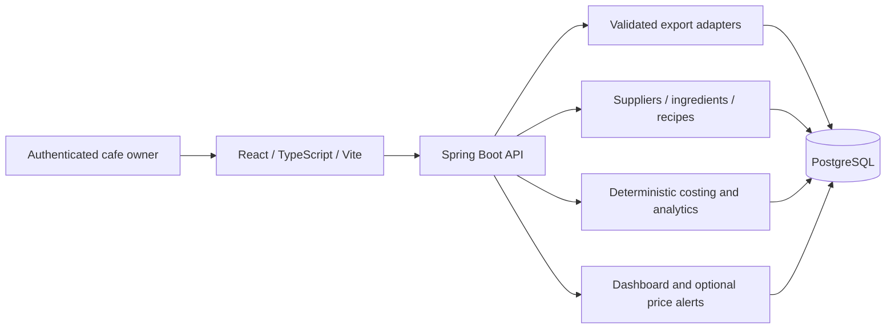

# VendorMargin Architecture Proposal

Status: proposed design for validation, not an implemented system. Stack choices listed in the PRD are confirmed; deployment topology, libraries, module boundaries, auth mechanism and performance targets below remain proposals. Read [PRD.md](PRD.md) for assumptions and [DATABASE.md](DATABASE.md) for persistence design.

## 1. Small modular monolith

Propose one Spring Boot application, one PostgreSQL database and one React SPA. Organize backend code by business capability in one build module initially. Module boundaries are package/service contracts, not separate deployments. Use a conventional controller -> application service -> repository flow; calculation functions remain independent of HTTP and vendor-specific parsing.

No Kafka, microservices, Kubernetes, CQRS framework, Redis, event sourcing, data warehouse or generalized workflow engine is justified for the pilot. Add infrastructure only after a measured requirement. Docker Compose supports local application/database setup; production hosting and backup facilities remain Q-07/Q-11.

## 2. Proposed backend capabilities

| Package boundary | Owns | Allowed collaboration |
|---|---|---|
| identity | Authenticated subject, membership, tenant context | Provides validated context to application services; no analytics rules |
| imports | Source profiles, parser adapters, staged rows, commit/retry | Calls catalogue mapping contracts; publishes committed facts to storage; no recipe cost formulas |
| catalogue | Suppliers, ingredients, pack factors, menu items and external mappings | Used by imports and recipes; no dependency on HTTP parser implementations |
| recipes | Versioned recipes and yield validation | References ingredients via catalogue IDs; no purchase-selection logic |
| costing | Historical price selection, conversion arithmetic, recipe costs, calculation runs | Reads committed facts/recipes using explicit query contracts; no UI or POS vendor dependency |
| analytics | Summary/menu reporting and coverage | Reads completed run results and sales totals with consistent filters |
| alerts (P1) | Comparable supplier price changes and acknowledgement | Uses purchase observations; no email delivery infrastructure initially |

Keep a small shared vocabulary for IDs, currency, dates and validation errors. Do not create a generic shared entity library or repository that bypasses ownership. Reporting queries may join tables in this single database when scoped and tested; do not force network-style abstraction between packages.

## 3. Import vertical slice first

1. Validate representative files and manually reconcile expected results before finalizing schemas or adapters (G1).
2. Authenticate membership, enforce upload limits/type checks and stage the file in bounded temporary storage.
3. Select an explicitly supported format version, parse rows and preserve provenance. Unsupported layouts fail with actionable feedback.
4. Preview mappings, excluded/rejected/duplicate rows and comparable totals. Do not auto-merge ambiguous products or identities.
5. User confirms a validated batch; atomically revalidate and commit facts under tenant scope. Clear errors distinguish blocked, failed and committed states.
6. Resolve missing catalogue mappings and publish recipes. Request calculation; show data completeness before percentages.

Proposed import states: STAGED -> VALIDATED or BLOCKED -> COMMITTED; operational failures use FAILED with safe retry metadata. Editing mappings invalidates validation until rerun. Parsing and commit must not share one long database transaction. Exact state transitions will be validated against the chosen adapter and UI.

**A-12 implementation proposal:** bounded synchronous processing first, with persisted batch/run status and one active mutation per tenant. A client timeout does not prove failure: status lookup and idempotent commit resolve uncertainty. Test against the 60-second import target before deployment. If processing routinely exceeds hosting request limits, use a small database-backed worker in the same app, with leases/recovery; do not build a queue preemptively. This choice is open until measurement.

## 4. Costing and reporting

Use BigDecimal calculation functions with explicit rounding, input dates, currency and policy version. Keep recipe cost distinct from revenue and refund interpretation. The PRD owns formulas and business assumptions; services implement those rules rather than inventing new ones.

Propose explicit immutable calculation runs over a consistent input revision, with line/component lineage. New data marks prior results stale; initial UI offers Recalculate. Read one completed run for summary and detail. Start with SQL sums and bounded line calculations; introduce materialized aggregates only if measured query times fail the pilot envelope.

Do not calculate authoritative money in JavaScript floating point. API monetary/quantity decimals are strings with currency/unit metadata; percentages and unavailable values have explicit representations. The UI formats server results and displays missing-input reasons, coverage counts and run freshness.

## 5. Frontend and API approach

Proposed screens: tenant sign-in/workspace, import/preview/status, mapping, supplier/ingredient list/editor, menu/recipe editor, and dashboard/menu table. P1 adds price-change list. Favor simple forms and tables before charts. Display pending/error/empty/stale/partial-data states deliberately.

Use typed request/response DTOs and runtime server validation; persistence entities are not API contracts. Proposed REST endpoints group by imports, catalogue, recipes, calculations and reports. Document pagination, filter/date semantics, errors, decimal fields and idempotency with the implementation. No generated SDK or universal form framework is required initially.

Authorization derives tenant context from verified membership; tenant selection is a request to switch to an authorized workspace, not trust in a supplied tenant_id. Return consistent not-found/forbidden behavior without resource enumeration. Validate all linked IDs. Use an allowlist for sort fields and bounded pagination.

## 6. Security and isolation design proposal

Confirmed outcome: secure tenant data isolation. Proposed defenses:

- Established authentication integration with Spring Security; **Q-07** selects provider/session model before a live pilot. Prefer managed identity if practical; do not build custom password/credential infrastructure by default.
- Same-origin SPA/API deployment and server-managed secure, HttpOnly sessions are a proposed simple approach. Confirm provider compatibility, CSRF protection, session expiry and revocation. If a token architecture is selected instead, document storage and threat tradeoffs before implementation.
- Membership authorization at the service boundary, tenant-scoped repositories, composite tenant foreign keys and RLS as detailed in DATABASE.md. Test runtime privileges, connection pooling and background paths rather than merely checking annotations.
- Bounded upload bytes, decompressed XLSX size, cell counts and processing time; no formula evaluation, macros or executable content. Treat filenames/cells as untrusted. Reject unsupported formats clearly.
- Minimize stored raw data; never log source rows, credentials, payment details or full customer records. Protect file/status/report access as strictly as primary APIs.
- Secrets supplied through environment/deployment secret handling, never source control. Real-data environments require TLS and agreed backup/retention/access procedures.

These proposals are a design baseline, not a completed security assessment. Tenant-isolation integration tests and upload abuse cases are release gates.

## 7. Development and operations

Use Java 21 and the specified stack. **Open technical choices:** Spring Boot/PostgreSQL/tool versions, Maven versus Gradle, auth provider, Java persistence approach and file-parser library. Select maintained compatible versions during implementation after G1; do not infer a version lock from this document. Proposed default is a Maven wrapper and conventional Spring persistence, subject to that decision.

Proposed future layout is backend/, frontend/ and deployment configuration at the root; it is not created by this task. Compose starts PostgreSQL and optionally the app; migrations run in a controlled manner using Flyway. Separate migration credentials from restricted application credentials.

GitHub Actions should run formatting/static checks, Java tests, PostgreSQL Testcontainers integration/migration tests, frontend typecheck/build and critical Playwright journeys. Use synthetic fixtures, not production exports or secrets. Dependency/security findings need triage; no unresolved exploitable issue affecting the pilot's access or ingestion path is acceptable.

Minimal observability: health checks, structured request/batch/run correlation IDs, error counts and processing duration. Avoid a full monitoring platform initially. Proposed operational evidence: a restored backup reproduces test counts and totals, a failed import safely retries, and access revocation prevents further requests. Recovery objectives are Q-11; a successful backup command alone is not recovery evidence.

## 8. Verification strategy and release gates

| Layer | Evidence required |
|---|---|
| Domain | JUnit golden worked examples for tax/discount interpretation, conversions, yield, historical costs, refunds, missing costs, rounding and weighted aggregate margin |
| Persistence | PostgreSQL Testcontainers tests for migrations, RLS under runtime role, composite FKs, concurrent deduplication, rollback and snapshot consistency |
| API | Validation/status contracts, membership enforcement, decimals and unavailable values, pagination/filter boundaries, idempotency and error sanitization |
| Browser | Playwright import -> preview -> commit -> map -> recipe -> calculate -> dashboard; invalid-file, incomplete-cost and unauthorized-access paths |
| Performance | Recorded hardware/dataset, bounded uploads, 10,000-row import and 100,000-row report targets from PRD; adjust assumptions explicitly if unsupported |
| Recovery | Forced interruption/retry, restored backup reconciliation, fresh/upgrade migrations and retention/deletion procedure review |

Security, reconciliation and calculation correctness cannot be deferred to meet a date. Numerical unit tests must use independent expected results, not reproduce implementation expressions. A test suite cannot validate unconfirmed POS semantics; operator reconciliation is a separate gate.

Refund tests must distinguish a same-period refund from a later-period refund: preserve the original fulfilment cost on its original date, and never charge that cost again on the refund row under proposed A-07.

## 9. Phase 2 seam and decisions

The reusable seam is normalized sales facts plus independent recipe/costing contracts. A future native POS adapter may produce those facts, but native order lifecycle, payment processing, offline synchronization, stock control and receipt APIs do not belong in Phase 1. Do not introduce empty POS modules or speculative event schemas.

Validate Q-01 through Q-06 before broad schema investment; Q-07/Q-08 before deployment/file-storage decisions; Q-09 before treating reports as accepted; Q-10 only if P1 alerts fit; Q-11 before live pilot. Architecture changes should cite observed constraints, not future scale alone.
