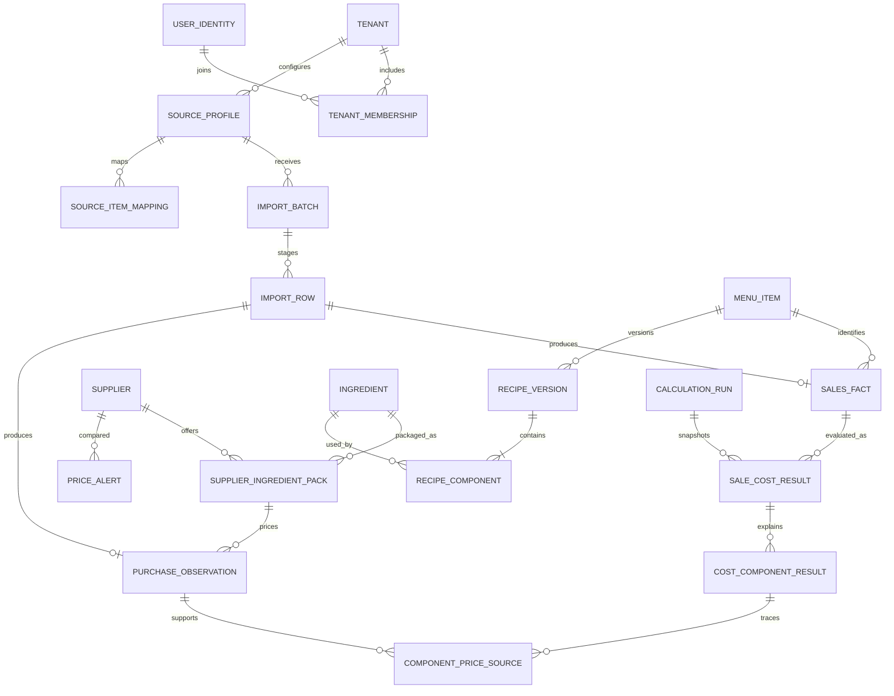

# VendorMargin Proposed Database Design

Status: conceptual PostgreSQL design, not DDL or a migration. Confirmed stack: PostgreSQL and Flyway. All entity, precision, indexing and tenancy mechanisms here are proposals subject to the [PRD assumptions](PRD.md#7-assumptions-and-open-decisions-register), especially G1 export validation. No inventory or proprietary POS entities are included.

## 1. Design principles

- Shared schema with tenant-owned rows is the proposed pilot design. Use application membership checks, tenant-scoped queries and PostgreSQL row-level security (RLS) together; security outcomes are mandatory, this mechanism is proposed.
- Proposed identifiers: UUID primary keys; source identifiers remain text. All tenant-owned tables have non-null tenant_id, id, created_at and relevant provenance/version fields.
- Add UNIQUE(tenant_id, id) on referenced tenant-owned records and composite foreign keys (tenant_id, referenced_id). A globally unique UUID alone does not prevent cross-tenant references.
- Tenant-sensitive unique keys begin with tenant_id. Global identity and immutable unit definitions are exceptions with narrowly defined access.
- Archive catalog records instead of cascading deletion into financial history. Tenant deletion requires a separate authorized, documented retention workflow; implementation is outside this design task.
- Business dates use date, event/creation timestamps use timestamptz. Store configured IANA timezone in tenant settings. Do not fabricate event timestamps from date-only exports.
- Proposed decimal types: quantities/factors numeric(20,6), normalized unit and calculated costs numeric(28,10), source monetary values numeric(24,6). Reject overflow/excess precision and verify products/division before persistence. No floating-point money.

## 2. Entity catalogue

All tables below are proposed; fields are essential conceptual fields, not an exhaustive schema. P0/P1 follows [PRD.md](PRD.md). Audit fields and tenant_id are implicit for tenant-owned entities.

| Entity / priority | Essential fields | Relationships and invariants |
|---|---|---|
| tenant / P0 | name, currency, business_timezone, data_revision, active | One pilot location per tenant under A-02; revision increments atomically on analytics-affecting mutations |
| user_identity / P0 | issuer, subject, active | Global unique (issuer, subject); no passwords if external identity is selected; not exposed as a global directory |
| tenant_membership / P0 | user_id, role, active | Unique (tenant_id, user_id); proposed owner role initially; explicit current membership for every request |
| source_profile / P0 | source_key, dataset_kind, adapter_version, format, configuration_version | Tenant-owned configured source; dataset kind sales or purchases; versioned mapping semantics |
| import_batch / P0 | source_profile_id, file_hash, original_filename, status, period, counts, totals, version, error_code | File hash scoped to tenant/source; track parsing/validation/commit state; filenames are untrusted display text |
| import_row / P0 | batch_id, sheet, row_number, source_key, disposition, normalized_payload, errors | Unique (tenant_id, batch_id, sheet, row_number); staged payload has bounded schema and retention; no committed fact until batch commit |
| supplier / P0 | display_name, external_reference, archived_at | Referenced by purchase observations; names are not reliable unique business IDs |
| unit_definition / P0 | code, dimension, base_factor | Global immutable g/kg/ml/L/each catalogue; no arbitrary cross-dimension conversion |
| ingredient / P0 | name, base_unit_code, fractional_each_allowed, archived_at | Base unit fixed once referenced unless explicit remapping/recalculation; no on-hand quantity |
| supplier_ingredient_pack / P0 | supplier_id, ingredient_id, supplier_sku, pack_base_quantity, effective_from, effective_to | Positive conversion; version changes pack size without rewriting past observations; no overlapping effective ranges per supplier SKU |
| menu_item / P0 | name, archived_at | Internal canonical menu identity; source SKU mappings live separately |
| source_item_mapping / P0 | source_profile_id, external_item_key, target_menu_item_id OR target_pack_id, version, active | Exactly one target matching source dataset kind; one active mapping per tenant/source/external key; keep mapping history |
| purchase_observation / P0 | import_row_id, source_profile_id, external_line_key, supplier_id, ingredient_id/pack_id, purchased_on, quantity_base, eligible_amount, unit_cost, currency, basis_status, kind | Positive eligible observations feed costs; credits remain typed evidence, not negative price observations; unresolved mapping/basis yields unavailable unit cost |
| sales_fact / P0 | import_row_id, source_profile_id, external_line_key, external_product_key, menu_item_id nullable, business_date, event_at nullable, quantity, net_revenue, currency, kind, related_sale_id nullable, cost_eligibility | One normalized detail or validated aggregate row; refunds/voids explicit; fulfilment ambiguity is not inferred away |
| recipe_version / P0 | menu_item_id, version, effective_from, effective_to, yield_servings, state, supersedes_id nullable | Positive yield; one published effective recipe per menu item/date; draft editable, published contents immutable |
| recipe_component / P0 | recipe_version_id, ingredient_id, input_quantity_base | Positive quantity; ingredients only, no nested recipes; sum repeated ingredient amounts or prohibit duplicates consistently |
| calculation_run / P0 | input_revision, policy_version, range_start, range_end, state, started_at, completed_at, totals, coverage_counts | Immutable completed snapshot; report date range is half-open [start, end); completed input revision may later be stale |
| sale_cost_result / P0 | calculation_run_id, sales_fact_id, recipe_version_id nullable, input_mapping_version, revenue, quantity_costed, estimated_cost nullable, reason_code | Unique (tenant_id, run_id, sales_fact_id); null cost requires reason; zero is valid only with explicit known inputs |
| cost_component_result / P0 | sale_cost_result_id, ingredient_id, quantity_used, unit_cost nullable, amount nullable | Records recipe contribution and missing-input reasons; allows explanation without rerunning current logic |
| component_price_source / P0 | cost_component_result_id, purchase_observation_id, weight | Links one or more same-date purchase observations used by A-06; positive weights normalized for quantity weighting |
| price_alert / P1 | supplier_id, ingredient_id, previous_date, current_date, policy_version, old_price, new_price, percent_change, status | Unique comparison key per tenant/supplier/ingredient/dates/policy; late inputs supersede stale comparisons |
| audit_event / P0 minimal | actor_id nullable, action, entity_type, entity_id, batch_or_run_id, occurred_at, outcome | Record import commit, mapping/recipe changes, membership changes and recalculation; no raw source rows/secrets in payload |

For one selected format, source IDs may require multiple columns rather than a single external_line_key. Finalize the canonical identity after G1. Do not use row number as a stable cross-file identity. If only daily aggregate data exists, define a disjoint period/grain key and reject conflicting overlap before adding that adapter.

## 3. Main relationships

Tenant ownership applies to every business entity even where omitted from this diagram. Import rows produce at most one fact of the dataset's type; summary rows produce no fact. Mapping/price references may be null while unresolved, with explicit status. Enforce cross-table dataset rules in service validation plus suitable constraints/triggers only where needed; do not assume a foreign key checks semantic type.

## 4. Integrity, history and transaction boundaries

**Import:** stage outside the financial commit; invalid batches cannot commit. On commit, lock the tenant's mutation/revision row, recheck validation version and uniqueness, insert all candidate facts, record counts/audit, increment revision and mark batch committed in one transaction. A failure rolls back facts and committed status together. Exact repeat and concurrent submissions cannot duplicate facts. A conflicting source identity is an error, not an automatic update.

**Recipes:** validate positive yield/components and nonoverlapping effective ranges. Proposed range semantics are [effective_from, effective_to), with null end meaning open-ended. Serialize publication for a menu item and enforce nonoverlap in PostgreSQL where practical. A correction explicitly supersedes earlier applicability; old contents and existing calculation references remain. The exact correction UI is open Q-09.

**Prices:** purchases are immutable normalized observations; pack conversions used at import are retained. A future pack edit cannot change historical quantity_base. Same-day weighted price selection preserves all observation IDs and weights. Unresolved purchase mappings need an explicit resolution operation that increments data_revision and records the old/new mapping.

**Calculations:** read a consistent database snapshot and the input revision; persist a complete run atomically, including component lineage. If new inputs commit meanwhile, the run remains valid for its snapshot but is displayed as stale. A failed run never becomes current. Start with bounded run ranges and one active run per tenant; re-evaluate storage cost after real volume measurements. Avoid a separate event store or aggregation warehouse.

## 5. Tenant isolation proposal

- Enable and force RLS on tenant-owned tables. Runtime role has no superuser, ownership bypass or BYPASSRLS privileges; migration role is separate.
- Set validated tenant context transaction-locally from authenticated membership, not arbitrary request headers. Missing context denies access. Reset/reuse behavior must be tested with connection pooling.
- Composite tenant foreign keys prevent a tenant's recipe from linking another tenant's ingredient even if IDs are known.
- Identity/membership lookup is a narrow authenticated bootstrap path: permit only the requesting subject's membership discovery, then enter a tenant transaction. Do not grant a general cross-tenant query path to ordinary services.
- Include tenant scope in background work, unique keys and file access. UUID secrecy is never authorization.
- Confirm RLS/session design in a small integration test before relying on it. If this cannot be made reliable within the schedule, redesign and verify isolation; do not silently remove the release gate.

## 6. Initial indexes and lifecycle

Proposed indexes: sales_fact(tenant_id, business_date, menu_item_id); purchase_observation(tenant_id, ingredient_id, purchased_on); purchase_observation(tenant_id, supplier_id, ingredient_id, purchased_on); import_batch(tenant_id, created_at); source identity uniqueness; recipe_version(tenant_id, menu_item_id, effective_from); calculation_run(tenant_id, state, completed_at); sale_cost_result(tenant_id, calculation_run_id, sales_fact_id). Add indexes from measured query plans, not speculative dashboards.

Flyway owns schema evolution. Test fresh migration and upgrade from the prior schema using PostgreSQL Testcontainers. Do not use destructive automatic schema recreation outside disposable tests. Prefer small forward migrations and backups before production changes; exact rollout/restore procedure remains Q-11.

Raw file persistence is **open Q-08**. Proposed pilot behavior is bounded temporary storage deleted after staging/failure; retain only required normalized evidence and error locations. Retention for staging rows, runs and audit events must be agreed before real data. Never retain customer/payment fields merely because an export contains them.

## 7. Database acceptance checklist

- Foreign tenant references and unscoped reads/writes fail under the runtime role, including native queries and pooled connections.
- Two simultaneous commits of the same source data result in one set of facts and deterministic duplicate/conflict handling.
- A forced mid-commit exception leaves zero partial facts; a repeated commit is safe.
- Effective-date boundaries choose one recipe and the correct historical purchase observations; no future prices leak backward.
- Numeric round trips preserve agreed precision; invalid quantities, overflow and inconsistent null/status combinations fail.
- Late inputs mark existing runs stale without changing their stored results; reports select one complete run.
- Fresh/upgrade migrations and restored backup counts/totals pass on PostgreSQL, not an in-memory database substitute.
